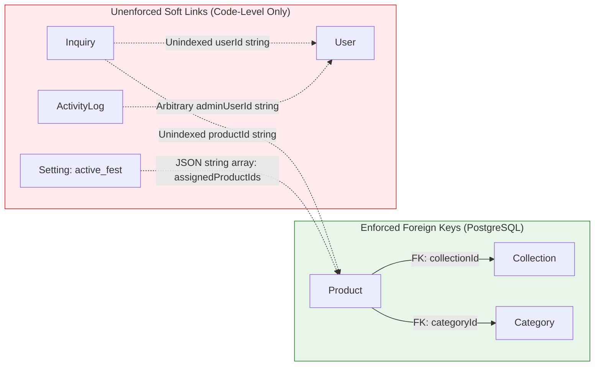
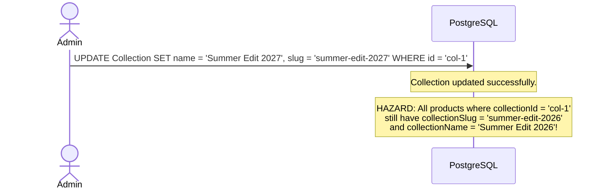
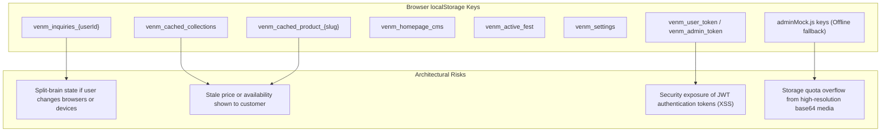
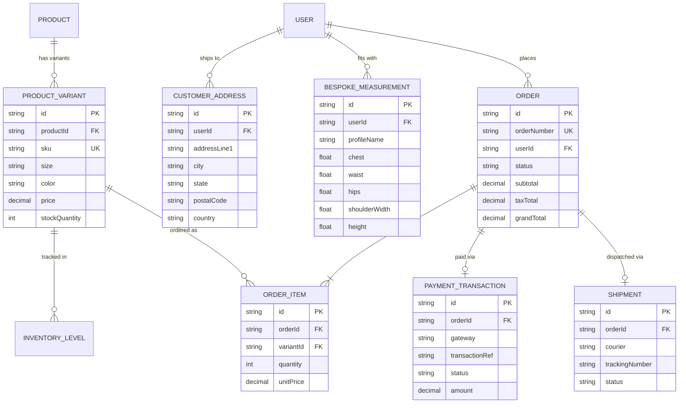

# VENM Database Architectural Audit & Integrity Report

**Author**: Senior Database Architect & Full-Stack Systems Engineer  
**Date**: October 2026  
**Target System**: VENM Catalog & Bespoke Fashion E-Commerce Platform  
**Database**: PostgreSQL 16 (Render Managed Cloud Instance) via Prisma Client ORM 6.4.0  

---

## 1. Executive Summary

This audit evaluates the database design, referential integrity, indexing strategy, data serialization patterns, and security architecture of the VENM platform. 

VENM currently operates as a **hybrid bespoke luxury catalog and lead-generation platform** rather than an instant self-checkout shopping cart. It features **10 verified tables** in production PostgreSQL. While the catalog and CMS models are operational, the schema relies heavily on **denormalized string cloning**, **unindexed query paths**, **application-level soft joins**, and **stringified JSON columns** (`JSON` stored in `TEXT` / `VARCHAR` types).

| Metric | Current State | Target Enterprise State |
| :--- | :--- | :--- |
| **Total Database Tables** | 10 verified | 18 - 20 (including full commerce & variants) |
| **Enforced Foreign Keys** | 2 (`collectionId`, `categoryId`) | 12+ (Inquiries, Logs, Media, Addresses) |
| **Explicit Non-PK Indexes** | 4 (all unique constraints) | 16+ (Query filters, foreign keys, timestamps) |
| **Data Integrity Level** | Moderate (Risk of dangling IDs) | High (Strict relational constraints & cascades) |
| **Variant Architecture** | Denormalized JSON array in Product | Normalized `ProductVariant` (SKU / Size / Color) |
| **Lead & Order System** | Bespoke Inquiries only | Inquiries + Orders + Bespoke Measurements |

---

## 2. Table-by-Table Status & Implementation Reality

| Entity / Table | Verified in DB | Active in Code | Implementation Classification | Primary Risk / Notes |
| :--- | :---: | :---: | :--- | :--- |
| `User` | Yes | Yes | **Production Active** | Token stored in `localStorage`; phone uniqueness un-normalized. |
| `Collection` | Yes | Yes | **Production Active** | Slug uniqueness enforced; status string un-indexed. |
| `Category` | Yes | Yes | **Production Active** | Redundant with `Product.category` string field. |
| `Product` | Yes | Yes | **Production Active** | JSON strings for `images`, `sizes`, `details`; missing FK indexes. |
| `Campaign` | Yes | Yes | **Partially Utilized** | Festive lighting and music URL fields modeled but unused in UI. |
| `HomepageSection`| Yes | Yes | **Production Active** | Duplicate CMS pattern with `Setting` table. |
| `Media` | Yes | Yes | **Partially Utilized** | Freeform `usedBy` string; not linked via FK to Product gallery. |
| `Setting` | Yes | Yes | **Production Active** | Stores `active_fest` product IDs as JSON array string. |
| `ActivityLog` | Yes | Yes | **Production Active** | High write volume; missing index on `createdAt` and `action`. |
| `Inquiry` | Yes | Yes | **Production Active** | No FK to `User` or `Product`; snapshots product metadata. |

---

## 3. Critical Architectural & Integrity Findings

### 3.1 Missing Foreign Keys & Dangling References

Only two database-level foreign keys exist in the entire schema:
1. `Product.collectionId -> Collection.id` (`ON DELETE SET NULL`)
2. `Product.categoryId -> Category.id` (`ON DELETE SET NULL`)

The following critical business relationships are **unenforced soft links**:



#### Detailed Breakdown:
* **`Inquiry.userId -> User.id`**:
  - *Current behavior*: In `inquiryController.js` (`getAllInquiries`), the controller extracts distinct `userId` values and performs a secondary query: `prisma.user.findMany({ where: { id: { in: userIds } } })`.
  - *Risk*: If a `User` record is purged or anonymized, existing inquiries retain a dangling string ID without referential integrity.
* **`Inquiry.productId -> Product.id`**:
  - *Current behavior*: Stored as an unvalidated string. To safeguard against broken links when products are renamed or deleted, the controller snapshots `productSlug`, `productName`, `productImage`, and `productPrice`.
  - *Risk*: No cascade or notification mechanism exists if a product is discontinued while inquiries are active.
* **`Setting(active_fest) -> Product.id`**:
  - *Current behavior*: Product IDs are serialized as `["cm7...", "cm8..."]` inside the `data` JSON string of the `active_fest` setting row.
  - *Risk*: When products are deleted in `AdminProducts.jsx`, their IDs remain inside the JSON array, requiring defensive client-side filtering to avoid rendering blank cards.
* **`ActivityLog.adminUserId -> User.id`**:
  - *Current behavior*: Accepts polymorphic actor strings (`'system-public'`, `'visitor'`, `'admin-1'`, or real user UUIDs).
  - *Risk*: Impossible to generate SQL `JOIN` queries for user audit reports without conditional application parsing.

---

### 3.2 Denormalization & Stale State Hazards

The `Product` table stores denormalized copies of related parent entities:
- `Product.collectionSlug`
- `Product.collectionName`
- `Product.category`



- **Hazard Scenario**: If an admin updates a collection's name or slug in `AdminCollections.jsx`, existing products pointing to `collectionId` retain the old `collectionSlug` and `collectionName` unless a manual multi-table update batch is executed.
- **Root Cause**: Product queries in `CollectionDetail.jsx` filter by `collectionSlug` rather than querying through the relational foreign key `collectionId`.

---

### 3.3 Text-Serialized JSON Columns

Multiple entities store structured data as serialized text strings:
1. `Product.images`: JSON string array `["/assets/...", "/assets/..."]`
2. `Product.sizes`: JSON string array `["S", "M", "L", "XL"]`
3. `Product.tags`: JSON string array `["festival", "velvet", "bespoke"]`
4. `Product.details`: JSON string object `{"fabric": "Silk", "embroidery": "Zari", ...}`
5. `HomepageSection.content`: JSON string storing banners, hero slides, and typography tokens.
6. `Setting.data`: JSON string storing global website configurations.
7. `Inquiry.userMeta`: JSON string storing customer snapshot metadata.

#### Problems Caused by Text-Serialized JSON:
- **No SQL Filtering**: It is impossible to execute high-performance queries such as `SELECT * FROM Product WHERE sizes CONTAINS 'XL'` or search products by tag using standard B-Tree indexing.
- **Serialization Vulnerabilities**: Malformed JSON strings cause runtime crashes in frontend components if `JSON.parse()` fails without a defensive `try/catch` fallback.
- **Zero Schema Enforcement**: Fields within the JSON object can change structure arbitrarily across releases without migration validation.

---

### 3.4 Missing Database Indexes

Currently, the database only possesses indexes automatically generated for Primary Keys (`id`) and Unique Constraints (`email`, `phone`, `slug`, `sectionKey`).

The following high-frequency query paths lack B-Tree indexes:

| Table | Column / Filter Path | Query Context | Performance Impact |
| :--- | :--- | :--- | :--- |
| `Product` | `collectionId` | Foreign key lookup | Sequential table scan on collection view |
| `Product` | `categoryId` | Foreign key lookup | Sequential table scan on category filter |
| `Product` | `collectionSlug` | `CollectionDetail.jsx` filter | Full table scan on every collection page load |
| `Product` | `availability` | `availability !== 'DRAFT'` | Scans entire catalog to exclude drafts |
| `Product` | `isFeatured`, `displayOrder` | Storefront featured carousel | Scans all products to sort top 6 |
| `Inquiry` | `userId` | `getMyInquiries` customer profile | Scans all inquiries on client profile visit |
| `Inquiry` | `status` | Admin inquiry filter by status | Full table scan on admin dashboard load |
| `Inquiry` | `createdAt` | `orderBy: { createdAt: 'desc' }` | Disk sort operation on every inquiry query |
| `ActivityLog` | `createdAt` | Last 24-hour timeline analytics | Full table scan across thousands of log records |
| `ActivityLog` | `action` | Filter logs by `USER_LOGIN` | Sequential scan across audit trail |

---

### 3.5 Client-Side `localStorage` vs. Database Ground Truth

The frontend relies heavily on browser `localStorage` as both an optimistic cache and a persistence fallback:



#### Key Vulnerabilities:
1. **Inquiry Synchronization Drift**: In `InquiryModal.jsx`, newly created inquiries are written to `localStorage.setItem('venm_inquiries_' + userId, ...)` as well as sent to the API. If the API request succeeds but the client clears their cache or visits from a mobile device, their inquiry history disappears from their profile page.
2. **Stale Cache Delivery**: Catalog items are cached under `venm_cached_product_{slug}` indefinitely until overwritten. If an admin marks an item as "SOLD OUT" or modifies pricing, a returning visitor may see stale pricing until the background revalidation completes.
3. **JWT Token Exposure**: Storing `venm_user_token` and `venm_admin_token` in `localStorage` allows any injected third-party script (XSS) to read the authorization token.

---

### 3.6 Security & API Governance Observations

1. **Unthrottled Public Telemetry Endpoints**:
   - `/api/analytics/heartbeat`
   - `/api/analytics/whatsapp-click`
   - `/api/analytics/inquiry-form`
   These endpoints accept unauthenticated `POST` requests and trigger `prisma.activityLog.create()`. A malicious script could flood the database with millions of fake activity log rows, exhausting connection pools and disk space.
2. **Phone Number Uniqueness Constraint**:
   - `User.phone` has a unique constraint (`@unique`). However, phone numbers are inputted as freeform strings (`+91 ...`, `0...`, or 10 digits). Inconsistent formatting can lead to duplicate account creation errors or bypasses.
3. **Dual Authentication Headers vs. Cookies**:
   - The backend supports both `cookie-parser` (`req.cookies.token`) and `Authorization: Bearer <token>`. While flexible, cookies lack CSRF token verification on state-changing `POST`/`PUT` endpoints.

---

## 4. Missing Commerce & Fashion Domain Entities

VENM currently lacks standard e-commerce transaction and inventory tracking tables. To evolve from a catalog showcase to an autonomous commerce platform, the following schema additions are required:



---

## 5. Phased Schema Modernization Roadmap

### Phase A: Referential Integrity & Performance (Zero Code Breaking Changes)
*Goal: Harden the existing database without modifying frontend contracts.*

1. **Add Foreign Key Constraints in Prisma**:
   - Add explicit relation: `Inquiry.userId -> User.id` (`onDelete: SetNull`).
   - Add explicit relation: `Inquiry.productId -> Product.id` (`onDelete: SetNull`).
2. **Add Crucial B-Tree Indexes**:
   ```prisma
   // Add to Product model in schema.prisma
   @@index([collectionId])
   @@index([categoryId])
   @@index([collectionSlug])
   @@index([availability])
   @@index([isFeatured, displayOrder])

   // Add to Inquiry model
   @@index([userId])
   @@index([clientContact])
   @@index([status])
   @@index([createdAt(sort: Desc)])

   // Add to ActivityLog model
   @@index([createdAt(sort: Desc)])
   @@index([action])
   @@index([entityType])
   ```
3. **Add Rate-Limiting Middleware**:
   - Implement `express-rate-limit` on `/api/analytics/*` and `/api/inquiries` (e.g., max 20 requests per IP per 15 minutes).

### Phase B: Data Normalization & Native JSONB (Minor Backend Refactor)
*Goal: Eliminate text-serialized JSON and sync denormalized strings automatically.*

1. **Migrate Stringified Columns to Native PostgreSQL `Json`**:
   - Change `Product.images`, `Product.sizes`, `Product.tags`, and `Product.details` from `String` to Prisma `Json`.
2. **Implement Collection Slug Cascade Triggers**:
   - In `collectionController.js`, when a collection slug is updated, execute a Prisma transaction updating all matching `Product.collectionSlug` records.
3. **Phone Number E.164 Normalization**:
   - Sanitize all phone numbers before user registration or inquiry logging to ensure consistent identity resolution.

### Phase C: Full Commerce & Bespoke Atelier Expansion (New Feature Release)
*Goal: Deploy full checkout, payments, and bespoke sizing.*

1. Deploy `ProductVariant` table to manage multi-size, multi-color SKUs with discrete inventory counts.
2. Deploy `BespokeMeasurement` table allowing Gen-Z shoppers to save custom tailoring measurements for direct atelier production.
3. Deploy `Order`, `OrderItem`, and `PaymentTransaction` tables integrated with Razorpay / Stripe.
