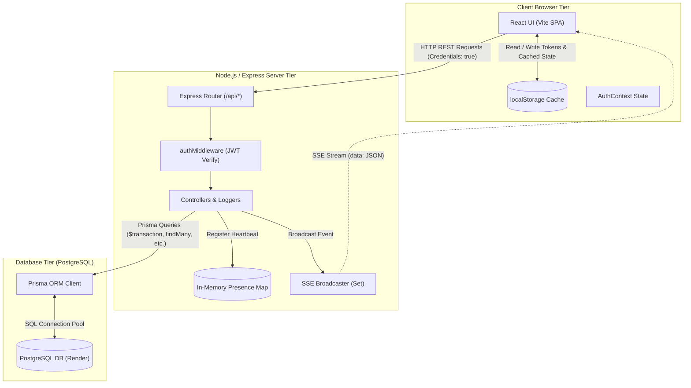
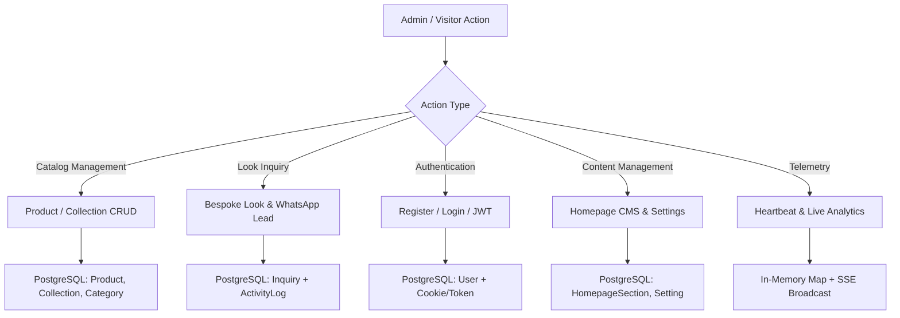
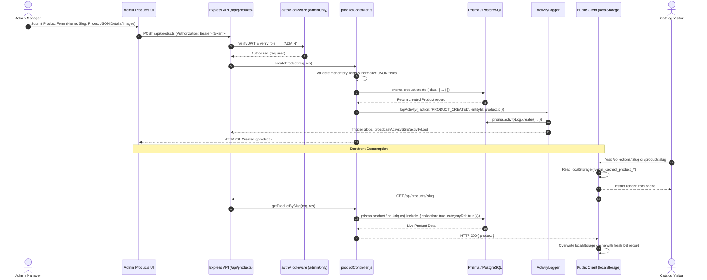
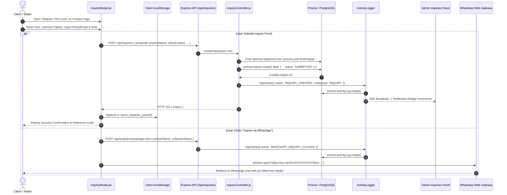
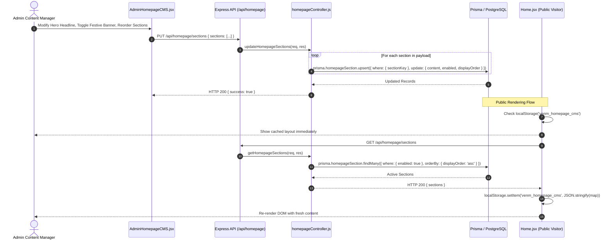
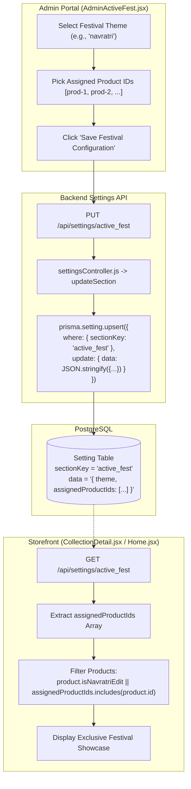
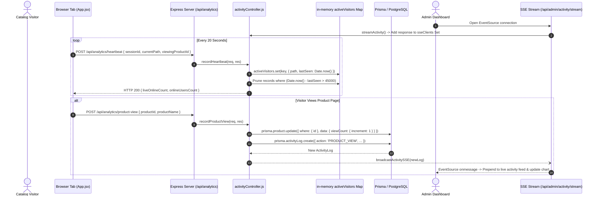

# VENM Data Flow Architecture

This document provides a comprehensive, end-to-end mapping of data movements across the VENM platform—from client-side user interactions and browser persistence layers, through the Express REST API and Prisma ORM, to the PostgreSQL database and real-time Server-Sent Events (SSE) telemetry.

---

## 1. Architectural Overview

VENM operates on a hybrid architecture combining a high-performance **PostgreSQL** relational database with an optimistic client-side **`localStorage` cache** and an asynchronous **Server-Sent Events (SSE)** telemetry stream.



### Architectural Distinctions
1. **Database Relational Constraints**: Strictly enforced only for `Product.collectionId -> Collection.id` and `Product.categoryId -> Category.id`.
2. **Application-Level Soft Links**: Managed programmatically in Node.js controllers without database foreign key constraints (e.g., `Inquiry.userId -> User.id`, `Inquiry.productId -> Product.id`, `ActivityLog.adminUserId -> User.id`).
3. **Optimistic LocalStorage Hydration**: The frontend hydrates state instantly from `localStorage` (`venm_cached_*`, `venm_homepage_cms`, `venm_settings`) before revalidating with live API responses to eliminate layout shifts.
4. **Volatile In-Memory State**: Active visitor presence and live tab heartbeats are kept in server memory (`activeVisitors` Map) with a 45-second TTL, rather than generating heavy database writes.

---

## 2. Core Workflow Data Flows



---

### Flow 1: Product Management Lifecycle (Admin CRUD to Storefront)

This flow traces how luxury fashion pieces are created, updated, and presented on the public catalog.



#### Step-by-Step Data Transformations
1. **Form Input Serialization**: Admin fills inputs. Images array, sizing charts, and product bullet points are serialized into JSON arrays/objects.
2. **Payload Submission**: Sent as JSON payload with Bearer JWT header to `POST /api/products`.
3. **Database Insertion**:
   - `collectionId` and `categoryId` link to parent entities with foreign key constraints.
   - Slug uniqueness is enforced by PostgreSQL unique index `Product_slug_key`.
   - Denormalized strings `collectionSlug`, `collectionName`, and `category` are written simultaneously for high-speed queries.
4. **Audit Log Generation**: `activityLogger.js` writes an audit trail to `ActivityLog` and executes `global.broadcastActivitySSE` to update admin analytics screens in real time.
5. **Storefront Cache Invalidation**: The storefront checks if local cache exists. Once the API returns updated data, it rewires React state and saves to `localStorage.setItem('venm_cached_product_' + slug, JSON.stringify(liveProduct))`.

---

### Flow 2: Bespoke Look Inquiry & WhatsApp Lead Capture

VENM functions as a high-end bespoke atelier platform where users "Request a Look" rather than checking out via a standard cart.



#### Step-by-Step Data Transformations
1. **User Identity Resolution**: If the user is logged in, `userId`, `clientName`, and `clientContact` are automatically extracted from `AuthContext`. If anonymous, visitor input is accepted.
2. **Denormalized Snapshotting**: `productSlug`, `productName`, `productImage`, and `productPrice` are cloned directly into the `Inquiry` row so that future price updates or product deletions do not alter historical inquiries.
3. **Audit & SSE Trigger**: Node.js logs the event in `ActivityLog` and pushes the payload down active SSE pipes.
4. **Dual-Channel Fallback**: If the customer prefers direct instant messaging, clicking WhatsApp triggers an analytics beacon to `/api/analytics/whatsapp-click` while opening the WhatsApp API with URI-encoded look metadata.

---

### Flow 3: Client & Admin Authentication Flow

```mermaid
sequenceDiagram
    autonumber
    actor User as Client / Admin
    participant AuthUI as Login / Register UI
    participant API as Express API (/api/auth)
    participant AC as authController.js
    participant DB as Prisma / PostgreSQL
    participant JWT as jsonwebtoken Engine
    participant AL as ActivityLogger

    User->>AuthUI: Enter credentials (Email/Phone + Password)
    AuthUI->>API: POST /api/auth/login or /api/auth/register
    API->>AC: login(req, res) or register(req, res)
    
    alt Register
        AC->>DB: prisma.user.findFirst({ where: { OR: [email, phone] } })
        DB-->>AC: Null (User does not exist)
        AC->>AC: bcrypt.hash(password, 10)
        AC->>DB: prisma.user.create({ data: { name, email, phone, passwordHash, role } })
        DB-->>AC: Created User Record
    else Login
        AC->>DB: prisma.user.findFirst({ where: { OR: [email, phone] } })
        DB-->>AC: User Record
        AC->>AC: bcrypt.compare(password, user.passwordHash)
    end

    AC->>JWT: sign({ id, role, email }, JWT_SECRET, { expiresIn: '7d' })
    JWT-->>AC: Signed Token String
    AC->>AL: logActivity({ action: 'USER_LOGIN', adminUserId: user.id })
    AL->>DB: prisma.activityLog.create()
    
    AC-->>AuthUI: Set-Cookie: token=<jwt>; HttpOnly; Secure<br/>HTTP 200 { user, token }
    AuthUI->>AuthUI: localStorage.setItem('venm_user_token', token)<br/>localStorage.setItem('venm_user', JSON.stringify(user))
    AuthUI-->>User: Redirect to Storefront or Admin Dashboard
```

#### Google Authentication Support
In `Login.jsx`, VENM also supports Google Authentication. The client retrieves the email/name, passes it to the backend authentication pipeline, and caches `venm_last_google_email` in `localStorage` for rapid subsequent sessions.

---

### Flow 4: Homepage CMS & Dynamic Layout Engine

VENM allows administrators to reorder, enable, disable, and customize homepage content without code deployments.



---

### Flow 5: Active Festival & Seasonal Campaign Settings

VENM features a dynamic "Active Fest" curation engine (e.g., Navratri, Diwali) that associates specific products with festival showcases.



---

### Flow 6: Real-time Visitor Telemetry & SSE Stream

VENM monitors live visitor presence and catalog interactions in real time using a lightweight heartbeat mechanism.



---

## 3. Frontend-to-Backend-to-Database Mapping Matrix

| Functional Module | Frontend Component | API Endpoint | HTTP Method | Controller Function | Prisma / DB Operation | Target Entities |
| :--- | :--- | :--- | :---: | :--- | :--- | :--- |
| **User Registration** | `Register.jsx` | `/api/auth/register` | `POST` | `register` | `prisma.user.create` | `User`, `ActivityLog` |
| **User Login** | `Login.jsx` | `/api/auth/login` | `POST` | `login` | `prisma.user.findFirst` | `User`, `ActivityLog` |
| **Catalog Listing** | `Collections.jsx` | `/api/collections` | `GET` | `getCollections` | `prisma.collection.findMany` | `Collection` |
| **Collection Detail** | `CollectionDetail.jsx` | `/api/collections/:slug` | `GET` | `getCollectionBySlug` | `prisma.collection.findUnique` | `Collection`, `Product` |
| **Product Detail** | `ProductDetail.jsx` | `/api/products/:slug` | `GET` | `getProductBySlug` | `prisma.product.findUnique` | `Product`, `Collection`, `Category` |
| **Product CRUD** | `AdminProducts.jsx` | `/api/products` | `POST`/`PUT`/`DELETE` | `createProduct`, `updateProduct`, `deleteProduct` | `prisma.product.*` | `Product`, `ActivityLog` |
| **Inquiry Submission** | `InquiryModal.jsx` | `/api/inquiries` | `POST` | `createInquiry` | `prisma.inquiry.create` | `Inquiry`, `ActivityLog`, `User` |
| **Customer Inquiries** | `Profile.jsx` | `/api/inquiries/my` | `GET` | `getMyInquiries` | `prisma.inquiry.findMany` | `Inquiry` |
| **Admin Inquiries** | `AdminInquiries.jsx` | `/api/inquiries/all` | `GET` | `getAllInquiries` | `prisma.inquiry.findMany` + in-memory user join | `Inquiry`, `User` |
| **Homepage CMS** | `AdminHomepageCMS.jsx` | `/api/homepage/sections` | `PUT` | `updateHomepageSections` | `prisma.homepageSection.upsert` | `HomepageSection` |
| **Media Library** | `AdminMediaLibrary.jsx` | `/api/media` | `GET`/`POST`/`DELETE` | `getAllMedia`, `createMedia`, `deleteMedia` | `prisma.media.*` | `Media` |
| **Store Settings** | `AdminSettings.jsx` | `/api/settings/:key` | `PUT` | `updateSection` | `prisma.setting.upsert` | `Setting` |
| **Active Fest** | `AdminActiveFest.jsx` | `/api/settings/active_fest` | `PUT` | `updateSection` | `prisma.setting.upsert` | `Setting` |
| **Live Telemetry** | `App.jsx` | `/api/analytics/heartbeat` | `POST` | `recordHeartbeat` | In-memory `activeVisitors` Map | *None (Volatile)* |
| **Activity Feed** | `AdminDashboard.jsx` | `/api/admin/activity/stream` | `GET` (SSE) | `streamActivity` | `global.broadcastActivitySSE` | `ActivityLog` |
