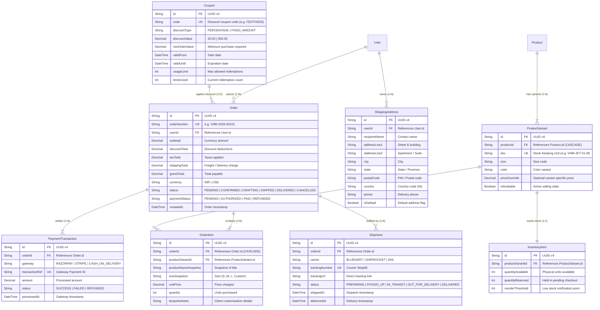

# VENM Catalog — Database Entity-Relationship Diagram (ERD)

**Project**: VENM Reference Catalog & Bespoke Fashion Platform  
**Architecture Role**: Senior Database Architect & Full-Stack Software Engineer  
**Database Engine**: PostgreSQL (Remote Render Instance with Connection Pooling)  
**ORM / Data Access Layer**: Prisma ORM 6.4.x (`@prisma/client`)  
**Audit Date**: October 2026  

---

## 1. Master Architectural Overview

The VENM platform functions as a **bespoke fashion reference catalog and custom garment styling request platform**, fusing traditional Gujarati craftsmanship (Garba silhouettes, mirrorwork, hand-loomed khadi) with contemporary Y2K kinetic cyber streetwear. 

Rather than operating as a conventional off-the-shelf shopping cart with fixed stock keeping units (SKUs) and instant checkout, VENM's data architecture is tailored around:
1. **Curated Reference Silhouettes**: Garment looks that can be commissioned, customized, or worked on using client-provided base garments.
2. **Bespoke Inquiries & Direct Consultation**: Capturing customized measurements, base garment source preferences, and WhatsApp consultations.
3. **Dynamic Festive Campaigns**: Editorial festival edits (e.g., *Navratri Edit*, *Diwali Edit*) with real-time assigned product mappings and custom ambient lighting flags.
4. **Real-time Presence & Activity Tracking**: In-memory heartbeat presence monitoring combined with persistent event-driven activity logging broadcast over Server-Sent Events (SSE).

---

## 2. Master Entity-Relationship Diagram

```mermaid
erDiagram
    %% =========================================================================
    %% DOMAIN 1: IDENTITY & ACCESS MANAGEMENT
    %% =========================================================================
    User {
        String id PK "UUID v4"
        String name "Full Name"
        String email UK "Unique Email Address"
        String phone UK "Unique 10-digit Phone"
        String passwordHash "Bcrypt Hash (Salt 10)"
        String role "CUSTOMER | ADMIN"
        DateTime createdAt "Auto timestamp"
        DateTime updatedAt "Auto timestamp"
    }

    ActivityLog {
        String id PK "UUID v4"
        String adminUserId FK "Soft reference -> User.id"
        String adminEmail "Actor email snapshot"
        String action "Audit Action Identifier"
        String entityType "PRODUCT | COLLECTION | INQUIRY | AUTH | SETTINGS"
        String entityId "Target Record ID"
        String entityName "Target Entity Title"
        String description "Detailed Event Narrative"
        String metadata "JSON serialized event metadata"
        DateTime createdAt "Auto timestamp"
    }

    %% =========================================================================
    %% DOMAIN 2: CATALOG & MERCHANDISE (CORE REFERENCES)
    %% =========================================================================
    Collection {
        String id PK "UUID v4"
        String name "Collection Title"
        String slug UK "Unique URL Slug"
        String tagline "Marketing Concept"
        String description "Curatorial Overview"
        String coverImage "Cover Asset Path / URL"
        String season "Season Code (e.g. FESTIVE 2026)"
        String status "ACTIVE | COMING_SOON"
        Boolean featured "Spotlighted on Homepage"
        Int displayOrder "Sorting Sequence"
        DateTime createdAt "Auto timestamp"
        DateTime updatedAt "Auto timestamp"
    }

    Category {
        String id PK "UUID v4"
        String name "Category Name (e.g. Outerwear)"
        String slug UK "Unique URL Slug"
        String description "Category Description"
        String status "Active | Inactive"
        Int displayOrder "Sorting Index"
        DateTime createdAt "Auto timestamp"
        DateTime updatedAt "Auto timestamp"
    }

    Product {
        String id PK "UUID v4 / Custom ID (e.g. vnm-001)"
        String name "Reference Garment Title"
        String slug UK "Unique URL Slug"
        String description "Craft & Cut Description"
        String details "JSON String Array: Spec Bullets"
        String collectionId FK "Foreign Key -> Collection.id"
        String categoryId FK "Foreign Key -> Category.id"
        String collectionSlug "Denormalized Slug"
        String collectionName "Denormalized Title"
        String category "Denormalized Category Name"
        String images "JSON String Array: Asset URLs"
        String sizes "JSON String Array: Sizing Tags"
        String availability "REQUESTABLE | PUBLISHED | PAUSED | COMING_SOON | DRAFT"
        String estimatedPrice "Formatted Starting Price"
        String minPrice "Minimum Estimated Price"
        String maxPrice "Maximum Estimated Price"
        String priceDisplayMode "STARTING_FROM | PRICE_RANGE | CUSTOM_QUOTE"
        String customizationInfo "Customization Guidelines"
        String sizingInfo "Tailoring & Fit Protocol"
        String sourceAttribution "Origin / Reference Credit"
        Boolean isFeatured "Featured on Homepage"
        Boolean isNavratriEdit "Assigned to Festival Edit"
        String tags "JSON String Array: Style Tags"
        String garmentCare "Care & Maintenance Instructions"
        Int viewCount "Real-time Look Popularity Counter"
        Int displayOrder "Catalog Sequence Index"
        DateTime createdAt "Auto timestamp"
        DateTime updatedAt "Auto timestamp"
    }

    %% =========================================================================
    %% DOMAIN 3: BESPOKE INQUIRIES & LEAD CAPTURE
    %% =========================================================================
    Inquiry {
        String id PK "UUID v4"
        String userId FK "Soft link -> User.id (Nullable)"
        String clientName "Client Full Name"
        String clientContact "Primary Contact (Phone or Email)"
        String clientEmail "Client Email"
        String clientPhone "Client Phone"
        String userMeta "JSON Snapshot of User Session"
        String productId FK "Soft link -> Product.id"
        String productSlug "Soft link -> Product.slug"
        String productName "Requested Reference Title"
        String productImage "Primary Cover Snapshot"
        String productPrice "Price Quote Snapshot"
        String collectionName "Collection Snapshot"
        String selectedSize "Requested Size / Custom Measurement"
        String requestType "I have my garment | Source base garment | WhatsApp"
        String note "Client Customization Notes"
        String status "SUBMITTED | CONTACTED | IN_PROGRESS | COMPLETED"
        DateTime createdAt "Auto timestamp"
        DateTime updatedAt "Auto timestamp"
    }

    %% =========================================================================
    %% DOMAIN 4: CONTENT MANAGEMENT & DIGITAL ASSETS
    %% =========================================================================
    Campaign {
        String id PK "UUID v4"
        String name "Campaign Title"
        String slug UK "Unique Campaign Slug"
        String description "Campaign Theme Vision"
        String image "Spotlight Banner Image URL"
        String announcement "Top Bar Announcement Text"
        String startDate "Optional Start Date"
        String endDate "Optional End Date"
        String status "ACTIVE | SCHEDULED | ENDED"
        String theme "Festive | Minimal | Street"
        Boolean festivalLights "Interactive Lights Toggle"
        Boolean dandiya "Interactive Dandiya Toggle"
        Boolean chunri "Interactive Chunri Toggle"
        Boolean bangles "Interactive Bangles Toggle"
        Boolean festivalGlow "Interactive Glow Filter Toggle"
        DateTime createdAt "Auto timestamp"
        DateTime updatedAt "Auto timestamp"
    }

    HomepageSection {
        String id PK "UUID v4"
        String sectionKey UK "hero | featured_collection | brand_statement | etc."
        String name "Section Display Label"
        Boolean enabled "Visibility Toggle"
        Int displayOrder "Vertical Layout Position"
        String content "JSON String of Modular Fields"
        DateTime createdAt "Auto timestamp"
        DateTime updatedAt "Auto timestamp"
    }

    Media {
        String id PK "UUID v4"
        String name "Asset Title / Filename"
        String url "File Path or CDN URL"
        String type "MIME Type (e.g. image/webp)"
        String size "Human-readable file size"
        String category "Asset Category (Products, Campaigns)"
        String usedBy "Usage Scope (Catalog, Homepage)"
        String altText "Accessibility / SEO Alt Text"
        DateTime createdAt "Auto timestamp"
        DateTime updatedAt "Auto timestamp"
    }

    Setting {
        String id PK "UUID v4"
        String sectionKey UK "general | whatsapp | social | seo | active_fest"
        String data "JSON String of Configuration Payload"
        DateTime createdAt "Auto timestamp"
        DateTime updatedAt "Auto timestamp"
    }

    %% =========================================================================
    %% RELATIONSHIPS
    %% =========================================================================
    %% Enforced Foreign Key Constraints in PostgreSQL Schema
    Collection ||--o{ Product : "1:N (Foreign Key: Product.collectionId -> Collection.id, onDelete: SetNull)"
    Category ||--o{ Product : "1:N (Foreign Key: Product.categoryId -> Category.id, onDelete: SetNull)"

    %% Application-Level Soft Joins (No DB Foreign Key Constraint)
    User ||--o{ Inquiry : "1:N soft link (Inquiry.userId -> User.id)"
    Product ||--o{ Inquiry : "1:N soft link (Inquiry.productId -> Product.id)"
    User ||--o{ ActivityLog : "1:N soft audit link (ActivityLog.adminUserId -> User.id)"
```

---

## 3. Verified Entities Breakdown by Domain

### Domain 1: Identity & Access Management
1. **`User`**: Holds client and administrator identities. Features unique email and optional 10-digit phone indexing, salted Bcrypt password hashing, and role-based differentiation (`CUSTOMER` vs. `ADMIN`).
2. **`ActivityLog`**: Provides immutable event auditing for all administrative actions, catalog modifications, authentication events, and lead submissions. Connected to a Server-Sent Events (SSE) broadcaster for live admin monitoring.

### Domain 2: Catalog & Merchandise Architecture
3. **`Collection`**: Represents themed seasonal edits (e.g., *Navratri Edit*, *Diwali Edit*, *Raw Denim*, *Contemporary Ethnic*). Contains metadata, season tags, and display ordering.
4. **`Category`**: High-level garment taxonomies (*Outerwear*, *Tops*, *Bottoms*, *Ethnic*, *Accessories*).
5. **`Product`**: The core style reference entity. Enforces uniqueness on `slug`, maintains relational foreign keys (`collectionId`, `categoryId`), and utilizes PostgreSQL text columns for JSON array serialization of images, spec bullet points, sizing tags, and style tags.

### Domain 3: Customer Leads & Bespoke Inquiries
6. **`Inquiry`**: Records bespoke garment commissions submitted either through the web modal or via WhatsApp redirect. Captures reference snapshots (title, price, image, collection), requested sizing, garment sourcing preferences (*Client Garment* vs. *VENM Sourced Base*), and full contact coordinates.

### Domain 4: Content Management, Media & Site Configuration
7. **`Campaign`**: Controls active festival marketing takeovers, announcement banners, and interactive festival UI switches (festival lights, animated dandiya sticks, chunri overlays, bangles, and neon glow effects).
8. **`HomepageSection`**: Modular CMS table governing the presentation, text copy, call-to-action buttons, and sequencing of homepage components (`hero`, `featured_collection`, `brand_statement`, `featured_products`, `lookbook`, `about_story`).
9. **`Media`**: Digital asset library storing image URLs, MIME types, file sizes, categories, and SEO alt texts.
10. **`Setting`**: Centralized key-value JSON configuration store holding global configuration partitions: `general`, `whatsapp`, `social`, `seo`, and `active_fest` (including festival product assignments).

---

## 4. Relationship Enforcement Matrix

| Relationship | Type | Database Constraint | Application Behavior |
| :--- | :--- | :--- | :--- |
| **Collection → Product** | 1:N | **Enforced** (`Product.collectionId` → `Collection.id`, `ON DELETE SET NULL`) | App also filters via denormalized `Product.collectionSlug` for performance and human-readable URLs. |
| **Category → Product** | 1:N | **Enforced** (`Product.categoryId` → `Category.id`, `ON DELETE SET NULL`) | App also filters via denormalized `Product.category` string. |
| **User → Inquiry** | 1:N | **Application-Level Soft Link** (No DB FK) | Controller manually looks up `User` by `userId` to enrich inquiry details. Supports guest inquiries with `userId = null`. |
| **Product → Inquiry** | 1:N | **Application-Level Soft Link** (No DB FK) | Product details (`productName`, `productPrice`, `productImage`, `productSlug`) are snapshot into `Inquiry` to survive catalog updates or deletions. |
| **User → ActivityLog** | 1:N | **Application-Level Soft Link** (No DB FK) | `adminUserId` accepts User UUIDs as well as system identifiers (`system-public`, `visitor`). |
| **Setting (active_fest) → Product** | N:M | **Application-Level JSON Array** | `Setting.data.assignedProductIds` stores an array of product UUIDs/slugs to assign products to the active festive showcase. |

---

## 5. Architectural Diagram: Future Commerce Domain (Recommended)

To transition VENM from a **Reference & Bespoke Inquiry Catalog** into a **Full Commercial E-Commerce Platform**, the following relational commerce domain should be integrated:

