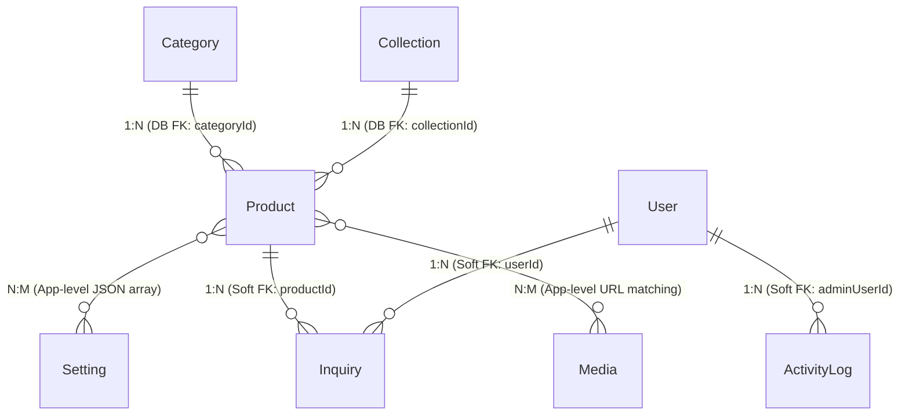

# VENM Platform — Comprehensive Database Architecture & Schema Specification

**Document Version**: 2.0 (Academic Presentation Edition)  
**System**: VENM Clothing Brand — Bespoke Fashion Reference Catalog & Lead Generation Platform  
**Target Database**: PostgreSQL 16 (Render Managed Cloud Instance)  
**Object-Relational Mapping (ORM)**: Prisma ORM 6.4.0 (`@prisma/client`)  
**Prepared By**: Senior Database Architect & Systems Engineer  
**Classification**: Academic Project Technical Documentation  

---

## Table of Contents

1. [Executive Project Overview](#1-executive-project-overview)
2. [Actual Database Technology & ORM Architecture](#2-actual-database-technology--orm-architecture)
3. [Complete Entity Catalog & Functional Domain Classification](#3-complete-entity-catalog--functional-domain-classification)
4. [Master Data Dictionary & Field Specifications](#4-master-data-dictionary--field-specifications)
   * 4.1 Collection Table
   * 4.2 Category Table
   * 4.3 Product Table
   * 4.4 User Table
   * 4.5 Inquiry Table
   * 4.6 ActivityLog Table
   * 4.7 Campaign Table
   * 4.8 HomepageSection Table
   * 4.9 Media Table
   * 4.10 Setting Table
5. [Primary Keys, Foreign Keys & Referential Integrity](#5-primary-keys-foreign-keys--referential-integrity)
6. [Relationship Cardinalities & Crow's-Foot Notations](#6-relationship-cardinalities--crows-foot-notations)
7. [Database Constraints, Uniqueness & Indexing Strategy](#7-database-constraints-uniqueness--indexing-strategy)
8. [Product Catalog Mechanics: Taxonomy, Denormalization & Hybrid JSON](#8-product-catalog-mechanics-taxonomy-denormalization--hybrid-json)
9. [Customer Inquiries & Lead Capture Mechanics: Point-in-Time Snapshotting](#9-customer-inquiries--lead-capture-mechanics-point-in-time-snapshotting)
10. [Admin Activity Logging & Real-Time Presence Mechanics](#10-admin-activity-logging--real-time-presence-mechanics)
11. [Website Settings & Modular Homepage CMS](#11-website-settings--modular-homepage-cms)
12. [Architectural Limitations & Future Normalization Roadmap](#12-architectural-limitations--future-normalization-roadmap)

---

## 1. Executive Project Overview

**VENM** is a luxury bespoke fashion catalog and custom design request platform based in Ahmedabad, Gujarat. The brand fuses traditional Gujarati textile heritage (Garba chaniya-choli silhouettes, mirrorwork, hand-loomed khadi, raw denim) with modern Y2K kinetic cyber-streetwear aesthetics.

### Business Model & Architectural Paradigm
Unlike off-the-shelf retail e-commerce stores (such as Amazon or Shopify) that deal in mass-produced, pre-packaged inventory with rigid Stock Keeping Units (SKUs) and immediate credit card checkout, VENM operates on a **bespoke consultation and custom tailoring workflow**:
1. **Reference Catalog**: Garments are showcased as *reference designs* indicating what the studio can custom fabricate, alter, or embroider.
2. **Two Sourcing Pathways**:
   * *Client-provided garment*: The client sends their own denim jacket, chaniya, or base garment to the studio for bespoke distressing and mirrorwork.
   * *Studio-sourced base*: VENM procures the base raw garment and customizes it to the client's bespoke measurements.
3. **Lead Capture & WhatsApp Bridge**: Customers configure customization parameters, size tags, and notes, which are recorded as database inquiries and forwarded directly to studio designers via authenticated WhatsApp deep-linking.

Consequently, the underlying database is purpose-built to balance **editorial media presentation**, **flexible garment styling specifications**, **immutable inquiry snapshots**, and **event-driven administrative auditing**.

---

## 2. Actual Database Technology & ORM Architecture

### 2.1 Database Management System: PostgreSQL 16
The production database is an enterprise-grade **PostgreSQL 16** relational database engine hosted on **Render Managed Cloud Infrastructure** (`dpg-db3ri60473hc73f36usg-a.oregon-postgres.render.com/venm_database`).

**Why PostgreSQL was chosen**:
* **Relational Rigor & ACID Guarantees**: Complete compliance with Atomicity, Consistency, Isolation, and Durability guarantees essential for user authentication and inquiry logging.
* **Hybrid Relational/Document Storage**: Exceptional native support for storing JSON and serialized text data alongside structured relational columns.
* **Concurrency & Connection Pooling**: Production connection string includes parameters `connection_limit=15&pool_timeout=30`, preventing socket exhaustion under sudden client traffic surges.

### 2.2 Data Access Layer: Prisma ORM 6.4.0
The backend interacts with PostgreSQL exclusively through **Prisma ORM** (`@prisma/client` version `6.4.0`).
* **Declarative Schema**: The complete relational model is codified in `prisma/schema.prisma`.
* **Type-Safe Query Builder**: Eliminates runtime SQL syntax errors by auto-generating TypeScript and JavaScript query clients.
* **Connection Lifecycle Management**: Managed via a singleton pattern in `server/config/db.js` attached to `globalThis` to prevent connection leaks during Express development reloads.

```
+-------------------------------------------------------------------------+
|                              REACT FRONTEND                             |
|             (Vite + React Router + Context API + TailwindCSS)           |
+------------------------------------+------------------------------------+
                                     |  HTTP REST / SSE
                                     v
+-------------------------------------------------------------------------+
|                           EXPRESS API SERVER                            |
|             (Node.js REST Controllers + Activity Logger Utility)        |
+------------------------------------+------------------------------------+
                                     |  Prisma Client Queries
                                     v
+-------------------------------------------------------------------------+
|                            PRISMA ORM 6.4.0                             |
|               (Connection Pool: Limit 15, Timeout 30s)                  |
+------------------------------------+------------------------------------+
                                     |  Native PostgreSQL Wire Protocol (SSL)
                                     v
+-------------------------------------------------------------------------+
|                         POSTGRESQL 16 (RENDER)                          |
|             (10 Production Tables, Indexes, Constraints)                |
+-------------------------------------------------------------------------+
```

---

## 3. Complete Entity Catalog & Functional Domain Classification

Inspection of `prisma/schema.prisma` confirms exactly **10 database tables**. No other tables exist in the verified database.

| # | Entity / Table Name | Functional Domain | Primary Business Function | Active In Code? |
| :-: | :--- | :--- | :--- | :---: |
| 1 | `User` | Identity & Access | Customer authentication, client accounts, admin role enforcement | Yes |
| 2 | `Collection` | Catalog & Taxonomy | Curated seasonal capsule edits (e.g., Navratri 2026, Core Edit) | Yes |
| 3 | `Category` | Catalog & Taxonomy | Standard garment classification (Outerwear, Tops, Ethnic, etc.) | Yes |
| 4 | `Product` | Product Management | Garment reference designs, specifications, pricing, media tags | Yes |
| 5 | `Inquiry` | Customer Inquiries | Bespoke customization requests, client contact, product snapshots | Yes |
| 6 | `ActivityLog` | Audit & Operations | Persistent system audit trail, admin action history, SSE broadcast | Yes |
| 7 | `Campaign` | Brand & Storefront | Festival campaign headers, dynamic interactive animation toggles | Yes |
| 8 | `HomepageSection` | Storefront CMS | Modular homepage content blocks, headline text, display orders | Yes |
| 9 | `Media` | Digital Asset Catalog | Metadata for uploaded garment photos, lookbooks, banners, logos | Yes |
| 10 | `Setting` | Storefront Config | Key-value store for WhatsApp templates, SEO tags, active fest IDs | Yes |

---

## 4. Master Data Dictionary & Field Specifications

### 4.1 `Collection` Table
Groups reference designs into editorial fashion narratives.

| Column Name | PostgreSQL Type | Nullable | Key / Constraint | Default Value | Description & Business Purpose |
| :--- | :--- | :---: | :---: | :---: | :--- |
| `id` | `VARCHAR(36)` / `TEXT` | No | **PK** | `uuid()` | Surrogate primary key (UUID v4) |
| `name` | `VARCHAR` / `TEXT` | No | - | - | Editorial collection title (e.g., "NAVRATRI EDIT") |
| `slug` | `VARCHAR` / `TEXT` | No | **UK** | - | Unique URL path parameter (`/collection/:slug`) |
| `tagline` | `VARCHAR` / `TEXT` | Yes | - | `null` | Marketing concept (e.g. "Gujarati Ethos × Cyber Streetwear") |
| `description` | `TEXT` | Yes | - | `null` | Extended curatorial narrative explaining the capsule |
| `coverImage` | `VARCHAR` / `TEXT` | No | - | - | Primary hero banner image asset URL / path |
| `season` | `VARCHAR` / `TEXT` | Yes | - | `null` | Season code (e.g., "FESTIVE 2026", "AUTUMN/WINTER") |
| `status` | `VARCHAR` / `TEXT` | No | - | `'ACTIVE'` | Visibility flag: `'ACTIVE'` or `'COMING_SOON'` |
| `featured` | `BOOLEAN` | No | - | `false` | When true, spotlights collection on the homepage |
| `displayOrder` | `INTEGER` | No | - | `0` | Sort weight for catalog menu ordering |
| `createdAt` | `TIMESTAMPTZ` | No | - | `now()` | Timestamp of record insertion |
| `updatedAt` | `TIMESTAMPTZ` | No | - | Auto (`@updatedAt`) | Timestamp of latest record mutation |

### 4.2 `Category` Table
Represents the structural taxonomy of garments.

| Column Name | PostgreSQL Type | Nullable | Key / Constraint | Default Value | Description & Business Purpose |
| :--- | :--- | :---: | :---: | :---: | :--- |
| `id` | `VARCHAR(36)` / `TEXT` | No | **PK** | `uuid()` | Surrogate primary key (UUID v4) |
| `name` | `VARCHAR` / `TEXT` | No | - | - | Human-readable taxonomy title (e.g., "Outerwear") |
| `slug` | `VARCHAR` / `TEXT` | No | **UK** | - | Unique URL slug (`/category/:slug`) |
| `description` | `TEXT` | Yes | - | `null` | Scope description of garment types in this category |
| `status` | `VARCHAR` / `TEXT` | No | - | `'Active'` | Category status: `'Active'` or `'Inactive'` |
| `displayOrder` | `INTEGER` | No | - | `0` | Sort weight for storefront navigation bars |
| `createdAt` | `TIMESTAMPTZ` | No | - | `now()` | Timestamp of record insertion |
| `updatedAt` | `TIMESTAMPTZ` | No | - | Auto (`@updatedAt`) | Timestamp of latest record mutation |

### 4.3 `Product` Table
The central entity of the system, representing reference looks available for bespoke commissioning.

| Column Name | PostgreSQL Type | Nullable | Key / Constraint | Default Value | Description & Business Purpose |
| :--- | :--- | :---: | :---: | :---: | :--- |
| `id` | `VARCHAR(36)` / `TEXT` | No | **PK** | `uuid()` | Surrogate primary key or custom code (e.g. `vnm-001`) |
| `name` | `VARCHAR` / `TEXT` | No | - | - | Reference design garment title |
| `slug` | `VARCHAR` / `TEXT` | No | **UK** | - | Unique URL slug (`/product/:slug`) |
| `description` | `TEXT` | Yes | - | `null` | Editorial description of craft, fabric, and silhouette |
| `details` | `TEXT` | No | - | `'[]'` | Serialized JSON string array of spec bullet points |
| `collectionId` | `VARCHAR(36)` / `TEXT` | Yes | **FK** | `null` | Foreign key referencing `Collection.id` (`ON DELETE SET NULL`) |
| `categoryId` | `VARCHAR(36)` / `TEXT` | Yes | **FK** | `null` | Foreign key referencing `Category.id` (`ON DELETE SET NULL`) |
| `collectionSlug` | `VARCHAR` / `TEXT` | Yes | - | `null` | Denormalized collection slug for zero-join filtering |
| `collectionName` | `VARCHAR` / `TEXT` | Yes | - | `null` | Denormalized collection name for quick UI card display |
| `category` | `VARCHAR` / `TEXT` | Yes | - | `null` | Denormalized category string (e.g. "Outerwear") |
| `images` | `TEXT` | No | - | `'[]'` | Serialized JSON string array of image asset paths/URLs |
| `sizes` | `TEXT` | No | - | `'[]'` | Serialized JSON string array of size tags (`["XS","S","M"]`) |
| `availability` | `VARCHAR` / `TEXT` | No | - | `'REQUESTABLE'` | `'REQUESTABLE'\|'PUBLISHED'\|'PAUSED'\|'COMING_SOON'\|'DRAFT'` |
| `estimatedPrice` | `VARCHAR` / `TEXT` | Yes | - | `'Estimated from ₹1,800'` | Formatted baseline pricing string shown on card |
| `minPrice` | `VARCHAR` / `TEXT` | Yes | - | `null` | Lower price boundary for range quoting |
| `maxPrice` | `VARCHAR` / `TEXT` | Yes | - | `null` | Upper price boundary for range quoting |
| `priceDisplayMode`| `VARCHAR` / `TEXT` | Yes | - | `'STARTING_FROM'` | Pricing mode: `'STARTING_FROM'`, `'PRICE_RANGE'`, `'CUSTOM_QUOTE'` |
| `customizationInfo`| `TEXT` | Yes | - | `'Custom embroidery...'` | Custom embroidery, fit adjustment, & alteration notes |
| `sizingInfo` | `TEXT` | Yes | - | `'Custom sizing...'` | Guidance on custom measurement submission |
| `sourceAttribution`| `VARCHAR` / `TEXT` | Yes | - | `'VENM Reference Design'` | Source label: studio creation vs client base piece |
| `isFeatured` | `BOOLEAN` | No | - | `false` | Featured toggle for homepage showcase grid |
| `isNavratriEdit` | `BOOLEAN` | No | - | `false` | Filter flag for active Navratri festival edit |
| `tags` | `TEXT` | No | - | `'[]'` | Serialized JSON string array of searchable keywords |
| `garmentCare` | `TEXT` | Yes | - | `null` | Washing, dry-cleaning, and fabric preservation guide |
| `viewCount` | `INTEGER` | No | - | `0` | Incremental counter tracking look popularity |
| `displayOrder` | `INTEGER` | No | - | `0` | Sort weight for catalog display ordering |
| `createdAt` | `TIMESTAMPTZ` | No | - | `now()` | Timestamp of record creation |
| `updatedAt` | `TIMESTAMPTZ` | No | - | Auto (`@updatedAt`) | Timestamp of latest record mutation |

### 4.4 `User` Table
Maintains client user accounts and administrative credentials.

| Column Name | PostgreSQL Type | Nullable | Key / Constraint | Default Value | Description & Business Purpose |
| :--- | :--- | :---: | :---: | :---: | :--- |
| `id` | `VARCHAR(36)` / `TEXT` | No | **PK** | `uuid()` | Surrogate primary key (UUID v4) |
| `name` | `VARCHAR` / `TEXT` | No | - | - | Client or administrator full name |
| `email` | `VARCHAR` / `TEXT` | No | **UK** | - | Unique login email address |
| `phone` | `VARCHAR` / `TEXT` | Yes | **UK** | `null` | Unique contact phone number (optional) |
| `passwordHash` | `VARCHAR` / `TEXT` | No | - | - | Bcrypt hashed password (salt factor 10) |
| `role` | `VARCHAR` / `TEXT` | No | - | `'CUSTOMER'` | Authorization role: `'CUSTOMER'` or `'ADMIN'` |
| `createdAt` | `TIMESTAMPTZ` | No | - | `now()` | Registration timestamp |
| `updatedAt` | `TIMESTAMPTZ` | No | - | Auto (`@updatedAt`) | Timestamp of profile update |

### 4.5 `Inquiry` Table
Records bespoke customization leads and snapshots garment state at submission time.

| Column Name | PostgreSQL Type | Nullable | Key / Constraint | Default Value | Description & Business Purpose |
| :--- | :--- | :---: | :---: | :---: | :--- |
| `id` | `VARCHAR(36)` / `TEXT` | No | **PK** | `uuid()` | Surrogate primary key (UUID v4) |
| `userId` | `VARCHAR(36)` / `TEXT` | Yes | **Soft FK** | `null` | Soft link to `User.id`; null for anonymous guests |
| `clientName` | `VARCHAR` / `TEXT` | Yes | - | `null` | Client's full name at inquiry submission |
| `clientContact` | `VARCHAR` / `TEXT` | Yes | - | `null` | Primary contact channel (phone or email string) |
| `clientEmail` | `VARCHAR` / `TEXT` | Yes | - | `null` | Client's email address |
| `clientPhone` | `VARCHAR` / `TEXT` | Yes | - | `null` | Client's telephone / WhatsApp contact number |
| `userMeta` | `TEXT` | Yes | - | `'{}'` | JSON string snapshot of client auth state & profile |
| `productId` | `VARCHAR(36)` / `TEXT` | Yes | **Soft FK** | `null` | Soft link to requested `Product.id` |
| `productSlug` | `VARCHAR` / `TEXT` | Yes | - | `null` | Immutable snapshot of product slug |
| `productName` | `VARCHAR` / `TEXT` | No | - | - | Immutable snapshot of product reference name |
| `productImage` | `VARCHAR` / `TEXT` | Yes | - | `null` | Immutable snapshot of product cover image URL |
| `productPrice` | `VARCHAR` / `TEXT` | Yes | - | `null` | Immutable snapshot of estimated price at inquiry time |
| `collectionName`| `VARCHAR` / `TEXT` | Yes | - | `null` | Immutable snapshot of associated collection title |
| `selectedSize` | `VARCHAR` / `TEXT` | Yes | - | `null` | Client-selected size tag or bespoke measurement tag |
| `requestType` | `VARCHAR` / `TEXT` | Yes | - | `'I have my garment'`| `'I have my garment'`, `'Source base garment'`, etc. |
| `note` | `TEXT` | Yes | - | `null` | Client-provided customization notes and embroidery requests |
| `status` | `VARCHAR` / `TEXT` | No | - | `'SUBMITTED'` | Lifecycle: `'SUBMITTED'\|'CONTACTED'\|'IN_PROGRESS'\|'COMPLETED'` |
| `createdAt` | `TIMESTAMPTZ` | No | - | `now()` | Submission timestamp |
| `updatedAt` | `TIMESTAMPTZ` | No | - | Auto (`@updatedAt`) | Timestamp of admin status alteration |

### 4.6 `ActivityLog` Table
Centralized operational audit trail tracking admin and client actions.

| Column Name | PostgreSQL Type | Nullable | Key / Constraint | Default Value | Description & Business Purpose |
| :--- | :--- | :---: | :---: | :---: | :--- |
| `id` | `VARCHAR(36)` / `TEXT` | No | **PK** | `uuid()` | Surrogate primary key (UUID v4) |
| `adminUserId` | `VARCHAR(36)` / `TEXT` | Yes | **Soft FK** | `null` | Soft reference to actor ID (`User.id`, `'admin-1'`, `'visitor'`) |
| `adminEmail` | `VARCHAR` / `TEXT` | Yes | - | `null` | Actor email snapshot at log event |
| `action` | `VARCHAR` / `TEXT` | No | - | - | Action identifier (e.g., `'PRODUCT_CREATED'`, `'INQUIRY_MUTATED'`) |
| `entityType` | `VARCHAR` / `TEXT` | No | - | - | Target domain (`'PRODUCT'`, `'COLLECTION'`, `'INQUIRY'`, etc.) |
| `entityId` | `VARCHAR(36)` / `TEXT` | Yes | - | `null` | Polymorphic record ID of modified entity |
| `entityName` | `VARCHAR` / `TEXT` | Yes | - | `null` | Human-readable title of the modified entity |
| `description` | `TEXT` | Yes | - | `null` | Natural language narrative summarizing the event |
| `metadata` | `TEXT` | Yes | - | `'{}'` | Serialized JSON string containing event context & diffs |
| `createdAt` | `TIMESTAMPTZ` | No | - | `now()` | Exact timestamp when activity occurred |

### 4.7 `Campaign` Table
Controls dynamic festive showcase headers and real-time visual effect toggles.

| Column Name | PostgreSQL Type | Nullable | Key / Constraint | Default Value | Description & Business Purpose |
| :--- | :--- | :---: | :---: | :---: | :--- |
| `id` | `VARCHAR(36)` / `TEXT` | No | **PK** | `uuid()` | Surrogate primary key (UUID v4) |
| `name` | `VARCHAR` / `TEXT` | No | - | - | Editorial campaign title (e.g. "NAVRATRI EDIT 2026") |
| `slug` | `VARCHAR` / `TEXT` | No | **UK** | - | Unique campaign slug identifier |
| `description` | `TEXT` | Yes | - | `null` | Narrative explaining campaign concept |
| `image` | `VARCHAR` / `TEXT` | Yes | - | `null` | Hero campaign banner URL |
| `announcement` | `VARCHAR` / `TEXT` | Yes | - | `null` | Sticky top-of-page alert banner copy |
| `startDate` | `VARCHAR` / `TEXT` | Yes | - | `null` | Campaign launch date string |
| `endDate` | `VARCHAR` / `TEXT` | Yes | - | `null` | Campaign expiry date string |
| `status` | `VARCHAR` / `TEXT` | No | - | `'ACTIVE'` | Status: `'ACTIVE'`, `'SCHEDULED'`, or `'ENDED'` |
| `theme` | `VARCHAR` / `TEXT` | Yes | - | `'Festive'` | Visual theme aesthetic |
| `festivalLights`| `BOOLEAN` | No | - | `true` | Frontend toggle: ambient festive fairy lights |
| `dandiya` | `BOOLEAN` | No | - | `true` | Frontend toggle: dandiya sticks graphic overlay |
| `chunri` | `BOOLEAN` | No | - | `true` | Frontend toggle: animated chunri silk banner |
| `bangles` | `BOOLEAN` | No | - | `false` | Frontend toggle: bangles graphic accent |
| `festivalGlow` | `BOOLEAN` | No | - | `true` | Frontend toggle: neon cyber glow filter |
| `createdAt` | `TIMESTAMPTZ` | No | - | `now()` | Record creation timestamp |
| `updatedAt` | `TIMESTAMPTZ` | No | - | Auto (`@updatedAt`) | Timestamp of latest campaign edit |

### 4.8 `HomepageSection` Table
Modular content management system for storefront layout.

| Column Name | PostgreSQL Type | Nullable | Key / Constraint | Default Value | Description & Business Purpose |
| :--- | :--- | :---: | :---: | :---: | :--- |
| `id` | `VARCHAR(36)` / `TEXT` | No | **PK** | `uuid()` | Surrogate primary key (UUID v4) |
| `sectionKey` | `VARCHAR` / `TEXT` | No | **UK** | - | Unique identifier (`hero`, `featured_collection`, etc.) |
| `name` | `VARCHAR` / `TEXT` | No | - | - | Administrative label for the section |
| `enabled` | `BOOLEAN` | No | - | `true` | Storefront visibility switch |
| `displayOrder` | `INTEGER` | No | - | `0` | Vertical display sequence index on landing page |
| `content` | `TEXT` | No | - | `'{}'` | Serialized JSON string containing modular text & CTAs |
| `createdAt` | `TIMESTAMPTZ` | No | - | `now()` | Record creation timestamp |
| `updatedAt` | `TIMESTAMPTZ` | No | - | Auto (`@updatedAt`) | Timestamp of latest section update |

### 4.9 `Media` Table
Digital asset catalog preserving asset metadata.

| Column Name | PostgreSQL Type | Nullable | Key / Constraint | Default Value | Description & Business Purpose |
| :--- | :--- | :---: | :---: | :---: | :--- |
| `id` | `VARCHAR(36)` / `TEXT` | No | **PK** | `uuid()` | Surrogate primary key (UUID v4) |
| `name` | `VARCHAR` / `TEXT` | No | - | - | File name or descriptive asset label |
| `url` | `VARCHAR` / `TEXT` | No | - | - | Local storage path or remote CDN image URL |
| `type` | `VARCHAR` / `TEXT` | Yes | - | `'image/webp'` | MIME format classification |
| `size` | `VARCHAR` / `TEXT` | Yes | - | `null` | Formatted file size string (e.g. "1.4 MB") |
| `category` | `VARCHAR` / `TEXT` | Yes | - | `'Products'` | Operational category (`Products`, `Campaigns`, `Lookbook`) |
| `usedBy` | `VARCHAR` / `TEXT` | Yes | - | `'Catalog'` | Module consuming the asset (`Catalog`, `Homepage`, `Admin`) |
| `altText` | `VARCHAR` / `TEXT` | Yes | - | `null` | Accessibility and SEO text |
| `createdAt` | `TIMESTAMPTZ` | No | - | `now()` | Upload timestamp |
| `updatedAt` | `TIMESTAMPTZ` | No | - | Auto (`@updatedAt`) | Timestamp of metadata mutation |

### 4.10 `Setting` Table
Global system configuration key-value repository.

| Column Name | PostgreSQL Type | Nullable | Key / Constraint | Default Value | Description & Business Purpose |
| :--- | :--- | :---: | :---: | :---: | :--- |
| `id` | `VARCHAR(36)` / `TEXT` | No | **PK** | `uuid()` | Surrogate primary key (UUID v4) |
| `sectionKey` | `VARCHAR` / `TEXT` | No | **UK** | - | Unique section identifier (`general`, `whatsapp`, `seo`, etc.) |
| `data` | `TEXT` | No | - | `'{}'` | Serialized JSON string storing configuration dictionary |
| `createdAt` | `TIMESTAMPTZ` | No | - | `now()` | Record creation timestamp |
| `updatedAt` | `TIMESTAMPTZ` | No | - | Auto (`@updatedAt`) | Timestamp of configuration change |

---

## 5. Primary Keys, Foreign Keys & Referential Integrity

### 5.1 Primary Key Strategy
All 10 tables implement surrogate primary keys using **Universally Unique Identifiers (UUID version 4)** generated automatically by Prisma's `@default(uuid())` directive.
* **Non-Sequential Security**: Sequential integers (`1, 2, 3...`) expose business metrics (e.g., total inquiry volume or total registered users) to external observers. UUIDs prevent ID enumeration attacks.
* **Distributed Generation**: IDs can be generated on the application server or database without central synchronization bottlenecks.

### 5.2 Database-Enforced Foreign Keys (PostgreSQL Level)
Only **two foreign keys** are enforced at the PostgreSQL database engine level:

```sql
-- 1. Product -> Collection
ALTER TABLE "Product" 
ADD CONSTRAINT "Product_collectionId_fkey" 
FOREIGN KEY ("collectionId") REFERENCES "Collection"("id") 
ON DELETE SET NULL ON UPDATE CASCADE;

-- 2. Product -> Category
ALTER TABLE "Product" 
ADD CONSTRAINT "Product_categoryId_fkey" 
FOREIGN KEY ("categoryId") REFERENCES "Category"("id") 
ON DELETE SET NULL ON UPDATE CASCADE;
```

**Referential Action: `ON DELETE SET NULL`**:
If an administrator deletes a `Collection` or `Category`, associated `Product` rows are **not destroyed**. Instead, their `collectionId` or `categoryId` fields are safely transitioned to `NULL`. This protects the product catalog from accidental cascade purges.

### 5.3 Application-Level Managed Relationships (Soft Links)
Five critical relationships are intentionally decoupled at the database level and managed via application logic in Express controllers:

| Source Entity | Source Field | Target Entity | Why Soft Link? (Architectural Rationale) |
| :--- | :--- | :--- | :--- |
| `Inquiry` | `userId` | `User` | **Guest Support**: Enables unregistered prospective clients to submit bespoke styling inquiries without mandatory account registration. |
| `Inquiry` | `productId` | `Product` | **Snapshot Integrity**: If a reference design is deleted from the public catalog, historical customer inquiries must retain original design details. |
| `ActivityLog` | `adminUserId` | `User` | **Polymorphic Actors**: Audit log records actors that are not registered user accounts (e.g., `'system-public'`, `'visitor'`, `'admin-1'`). |
| `ActivityLog` | `entityId` | Polymorphic | Points dynamically to records across 10 tables depending on the `entityType` column. Cannot be bound to a single SQL foreign key. |
| `Setting` | `assignedProductIds` | `Product` | Serialized inside the `data` JSON string of the `active_fest` setting row as `["vnm-001", "vnm-002"]`. |

---

## 6. Relationship Cardinalities & Crow's-Foot Notations

The following diagram illustrates the verified relationships between all 10 entities using standard crow's-foot cardinality notation:



### Cardinality Explanations

1. **`Collection` to `Product` (1 : N)**:
   * *Cardinality*: One `Collection` may contain zero, one, or many (`0..N`) `Product` records.
   * *Modality*: A `Product` belongs to zero or one (`0..1`) `Collection` (because `collectionId` is nullable).
   * *Prisma Schema*: `collection Collection? @relation(fields: [collectionId], references: [id], onDelete: SetNull)`.

2. **`Category` to `Product` (1 : N)**:
   * *Cardinality*: One `Category` may contain zero, one, or many (`0..N`) `Product` records.
   * *Modality*: A `Product` belongs to zero or one (`0..1`) `Category` (because `categoryId` is nullable).
   * *Prisma Schema*: `categoryObj Category? @relation(fields: [categoryId], references: [id], onDelete: SetNull)`.

3. **`User` to `Inquiry` (1 : N Soft Link)**:
   * *Cardinality*: One registered `User` may submit zero, one, or many (`0..N`) `Inquiry` records.
   * *Modality*: An `Inquiry` may have zero or one (`0..1`) associated `User` (guests have `userId = null`).

4. **`Product` to `Inquiry` (1 : N Soft Link)**:
   * *Cardinality*: One `Product` reference design may receive zero, one, or many (`0..N`) inquiries.
   * *Modality*: An `Inquiry` references zero or one (`0..1`) catalog product.

5. **`User` to `ActivityLog` (1 : N Soft Link)**:
   * *Cardinality*: One `User` actor can generate zero, one, or many (`0..N`) log entries.
   * *Modality*: An `ActivityLog` entry can reference zero or one (`0..1`) registered user accounts.

6. **`Product` to `Setting (active_fest)` (N : M Soft Link)**:
   * *Cardinality*: Multiple products can be assigned to the active festive setting, and products can exist across multiple settings configurations.

---

## 7. Database Constraints, Uniqueness & Indexing Strategy

### 7.1 Existing Unique Key Constraints (UK)
PostgreSQL automatically constructs B-tree indexes for all unique constraints defined in `prisma/schema.prisma`:

| Table | Column | Constraint Name | Purpose |
| :--- | :--- | :--- | :--- |
| `User` | `email` | `User_email_key` | Prevents duplicate user accounts with identical email addresses |
| `User` | `phone` | `User_phone_key` | Enforces unique phone numbers when provided |
| `Collection` | `slug` | `Collection_slug_key` | Ensures URL uniqueness for collection landing pages |
| `Category` | `slug` | `Category_slug_key` | Ensures URL uniqueness for category views |
| `Product` | `slug` | `Product_slug_key` | Ensures clean, collision-free product URLs |
| `Campaign` | `slug` | `Campaign_slug_key` | Guarantees unique campaign routes |
| `HomepageSection` | `sectionKey` | `HomepageSection_sectionKey_key` | Enforces unique CMS block identifiers |
| `Setting` | `sectionKey` | `Setting_sectionKey_key` | Guarantees exactly one configuration payload per section |

### 7.2 Indexing Audit & Query Optimization Gaps
While unique keys are automatically indexed, **foreign key and timestamp columns currently lack non-unique B-tree indexes**:

* **Unindexed Foreign Keys**: In PostgreSQL, adding a foreign key constraint (`FOREIGN KEY (collectionId) REFERENCES Collection(id)`) does *not* automatically create an index on `Product.collectionId`. Consequently, filtering products by collection or executing joins triggers full table sequential scans.
* **Unindexed Timestamp Queries**: `ActivityLog.createdAt` and `Inquiry.createdAt` are frequently queried with descending order (`ORDER BY createdAt DESC`), but lack indexes.

```sql
-- RECOMMENDED PERFORMANCE INDEXES (FUTURE MIGRATION):
CREATE INDEX "idx_product_collectionId" ON "Product"("collectionId");
CREATE INDEX "idx_product_categoryId" ON "Product"("categoryId");
CREATE INDEX "idx_inquiry_userId" ON "Inquiry"("userId");
CREATE INDEX "idx_inquiry_createdAt" ON "Inquiry"("createdAt" DESC);
CREATE INDEX "idx_activity_createdAt" ON "ActivityLog"("createdAt" DESC);
```

---

## 8. Product Catalog Mechanics: Taxonomy, Denormalization & Hybrid JSON

### 8.1 Dual-Taxonomy Architecture
The catalog implements a two-tier organizational model:
1. **Editorial Collections (`Collection`)**: Temporary or seasonal groupings (e.g., *Navratri Edit 2026*, *Winter Capsule*).
2. **Structural Categories (`Category`)**: Permanent garment taxonomy (e.g., *Outerwear*, *Tops*, *Bottoms*, *Ethnic*).

### 8.2 Denormalization Rationale
Notice that `Product` contains redundant columns mirroring data from `Collection` and `Category`:
* `Product.collectionSlug`
* `Product.collectionName`
* `Product.category`

**Why was this denormalized?**
In high-throughput e-commerce catalog endpoints (`GET /api/products?collection=navratri&category=Outerwear`), denormalization allows the server to execute a single-table filter on `Product` without issuing relational `JOIN` statements to `Collection` and `Category`. This minimizes query latency on cloud database instances.

*Trade-off*: When an administrator updates a collection's title or slug in the admin panel, the backend must update the corresponding products to maintain data consistency.

### 8.3 Hybrid Relational/JSON Pattern
Prisma models `details`, `images`, `sizes`, and `tags` as string columns (`String @default("[]")`) containing serialized JSON strings:
* **Images**: `["/assets/products/vnm-001-front.webp", "/assets/products/vnm-001-back.webp"]`
* **Sizes**: `["XS", "S", "M", "L", "XL", "Bespoke Measurements"]`
* **Details**: `["Hand-loomed Gujarati khadi denim", "Real mirrorwork embroidery", "Y2K kinetic boxy fit"]`
* **Tags**: `["streetwear", "navratri", "mirrorwork", "denim"]`

This gives the catalog flexibility to store varying numbers of images, specs, and sizing tags per garment without creating 4 additional child tables. The backend automatically parses these JSON strings before sending responses to the React frontend.

---

## 9. Customer Inquiries & Lead Capture Mechanics: Point-in-Time Snapshotting

### 9.1 The Order Immobility Problem
In conventional databases, an order references a product by foreign key (`order.productId -> product.id`). However, if a boutique later modifies the garment's name, changes its price from ₹1,800 to ₹3,500, or deletes the lookbook entry entirely, the historical order record becomes distorted or points to a non-existent product.

### 9.2 The Point-in-Time Snapshotting Solution
To solve this, VENM's `Inquiry` model captures an **immutable historical snapshot** of the garment at the exact second the inquiry is submitted:
* `productName`: Cloned from `Product.name`
* `productSlug`: Cloned from `Product.slug`
* `productImage`: Cloned from the primary asset in `Product.images`
* `productPrice`: Cloned from `Product.estimatedPrice`
* `collectionName`: Cloned from `Product.collectionName`

If an administrator deletes the reference design from the catalog tomorrow, **existing customer inquiries remain 100% intact, readable, and legally auditable**.

### 9.3 Guest vs Registered Client Resolution
The inquiry controller (`server/controllers/inquiryController.js`) handles both anonymous visitors and authenticated users gracefully:
```javascript
// Excerpt from inquiryController.js
const effectiveUserId = userId || req.user?.id || null;
const effectiveName = clientName || registeredUser?.name || 'Registered Client';
const effectiveEmail = clientEmail || registeredUser?.email || null;
const effectivePhone = clientPhone || registeredUser?.phone || null;
```
If a logged-in client submits an inquiry, their `User.id` is linked. If a guest submits an inquiry, `userId` is set to `null` while their raw contact details (`clientContact`, `clientPhone`, `clientEmail`) are preserved in the inquiry record.

---

## 10. Admin Activity Logging & Real-Time Presence Mechanics

### 10.1 Centralized Audit Pipeline
Every state mutation (creating products, updating collection statuses, changing inquiry progress) invokes `logActivity()` in `server/utils/activityLogger.js`.

The `ActivityLog` table captures:
* **Actor Identification**: `adminUserId` and snapshot `adminEmail`.
* **Action Verb**: Semantic constants (`PRODUCT_CREATED`, `INQUIRY_STATUS_CHANGED`, `MEDIA_UPLOADED`).
* **Polymorphic Target**: `entityType` (`PRODUCT`, `COLLECTION`, `INQUIRY`, `MEDIA`, `SETTINGS`) and `entityId`.
* **Context Payload**: Serialized `metadata` JSON capturing diffs or client IP addresses.

### 10.2 Server-Sent Events (SSE) Live Broadcast
When a record is inserted into `ActivityLog`, the backend immediately triggers a push event to all connected administrative dashboards over an active Server-Sent Events (SSE) channel:
```javascript
global.broadcastActivitySSE = (activityLog) => {
  const payload = `data: ${JSON.stringify(activityLog)}\n\n`;
  for (const clientRes of sseClients) {
    clientRes.write(payload);
  }
};
```
This enables the admin dashboard to display live activity feeds without client-side polling.

### 10.3 In-Memory Heartbeat Presence Tracking
Real-time visitor counts are decoupled from the PostgreSQL database to avoid excessive write overhead:
* Active client browser tabs send periodic heartbeat pings (`POST /api/analytics/heartbeat`).
* The server stores active sessions in an in-memory `Map` with a 45-second sliding expiration window.
* This provides instant online visitor counts without burdening the relational database with 100,000 ephemeral heartbeat writes per hour.

---

## 11. Website Settings & Modular Homepage CMS

### 11.1 Dynamic Key-Value Architecture (`Setting`)
Storefront settings are consolidated in the `Setting` table, where each row represents a logical settings partition identified by `sectionKey`:
* `general`: Brand identity, studio phone, email, physical studio address in Ahmedabad.
* `whatsapp`: Studio WhatsApp number and the default templated inquiry message with mustache variable tags (`{{product_name}}`, `{{estimated_price}}`, `{{product_url}}`).
* `social`: Links to Instagram, Facebook, and YouTube channels.
* `seo`: Default meta titles, OpenGraph preview banner paths, and meta descriptions.
* `active_fest`: Stores an array of product IDs featured in the active festival edit (`assignedProductIds`).

### 11.2 Modular Storefront Blocks (`HomepageSection`)
The live landing page is constructed dynamically from rows in `HomepageSection`:
* Each block has an `enabled` boolean flag and a `displayOrder` integer.
* The actual block content (hero images, button labels, badge texts) is stored as a JSON object inside `HomepageSection.content`.
* This architecture allows the brand administrator to reorder landing page sections, hide festival banners after Navratri concludes, or change hero copy without modifying React source code.

---

## 12. Architectural Limitations & Future Normalization Roadmap

To maintain academic transparency, the following technical trade-offs in the current schema are documented alongside their future enterprise solutions:

| Current Schema Limitation | Architectural Consequence | Future Enterprise Target State |
| :--- | :--- | :--- |
| **Stringified JSON in TEXT columns** (`details`, `images`, `sizes`, `content`) | PostgreSQL cannot validate JSON structure or execute index-assisted JSON sub-property queries. | Migrate column data types to native **`JSONB`** with GIN indexing (`CREATE INDEX ON "Product" USING GIN ("details")`). |
| **Missing Foreign Keys on Inquiries** (`Inquiry.userId`, `Inquiry.productId`) | If a user account is deleted, existing inquiries retain orphaned string IDs without referential enforcement. | Add explicit PostgreSQL foreign keys with `ON DELETE SET NULL` while retaining snapshot columns for historical integrity. |
| **Variant Arrays in Product** (`Product.sizes`) | Cannot track inventory quantities, pricing variations, or SKU codes per individual size/color combination. | Normalize into a dedicated **`ProductVariant`** table: `id, productId (FK), sku, size, color, stockQuantity, price`. |
| **Denormalized Collection/Category Strings** | Renaming a collection requires an application-level batch update across all child products. | Strictly normalize lookups via foreign keys and use database views (`CREATE VIEW "CatalogView" AS...`) for high-speed queries. |
| **Unindexed Foreign Keys & Timestamps** | Table scans occur when sorting logs or filtering products by collection on large datasets. | Add explicit B-tree indexes on `collectionId`, `categoryId`, `createdAt`, and `action`. |
| **Polymorphic `ActivityLog.entityId`** | Relational databases cannot enforce foreign key integrity across multiple tables on a single column. | Maintain `entityId` as a generic identifier, or implement domain-specific audit tables (`ProductAudit`, `InquiryAudit`). |

---

## Summary for Presentation

The VENM database architecture represents a **balanced, pragmatic design** tailored specifically to the requirements of a boutique bespoke clothing brand. By combining **PostgreSQL relational integrity** for core taxonomies with **JSON flexibility** for media/styling specs and **immutable snapshotting** for customer inquiries, the system achieves both operational agility and audit-proof historical reliability.
